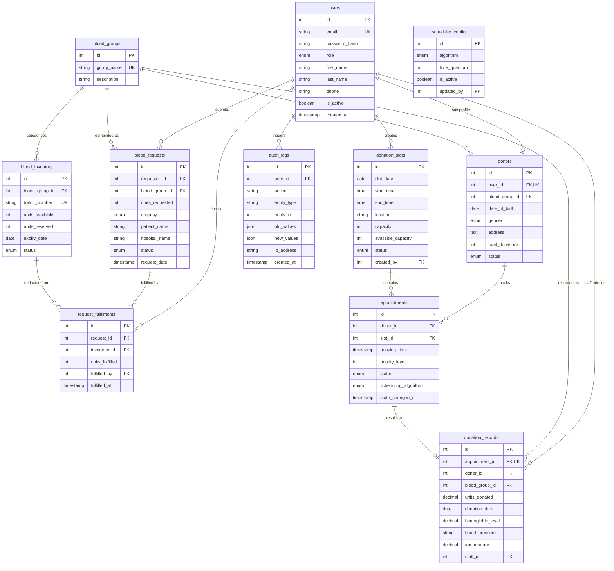

# Database Entity-Relationship (ER) Documentation

## 1. Entity-Relationship Diagram (Mermaid)

---

## 2. Normalization Analysis (Targeting BCNF)

1. **First Normal Form (1NF)**:
   - All columns contain atomic, indivisible values.
   - Every table has a well-defined primary key.
   - No repeating groups or multivalued attributes.

2. **Second Normal Form (2NF)**:
   - Satisfies 1NF.
   - All non-key attributes are fully functionally dependent on the primary key. In tables with composite keys such as the unique constraint `uq_donor_slot(donor_id, slot_id)`, synthetic auto-increment primary keys (`appointments.id`) are used.

3. **Third Normal Form (3NF)**:
   - Satisfies 2NF.
   - Transitive dependencies are removed. Donor profile details (`blood_group_id`, `address`) are stored in `donors` and not duplicated inside `appointments`. Blood group information is strictly referenced through the `blood_groups` reference table.

4. **Boyce-Codd Normal Form (BCNF)**:
   - For every functional dependency $X \to Y$, $X$ is a superkey.
   - In `appointments`, the candidate keys are `id` and `(donor_id, slot_id)`. Both are unique and minimal superkeys.

---

## 3. Database Integrity & Constraints

- **Foreign Key Actions**:
  - `donors.user_id -> users.id`: `ON DELETE CASCADE`
  - `appointments.donor_id -> donors.id`: `ON DELETE CASCADE`
  - `appointments.slot_id -> donation_slots.id`: `ON DELETE CASCADE`
  - Reference tables like `blood_groups` enforce `ON DELETE RESTRICT` to prevent accidental loss of classification.

- **Check Constraints**:
  - `chk_capacity_positive`: `capacity > 0`
  - `chk_avail_capacity_valid`: `available_capacity >= 0 AND available_capacity <= capacity`
  - `chk_units_non_negative`: `units_available >= 0`
  - `chk_units_req_positive`: `units_requested > 0`
